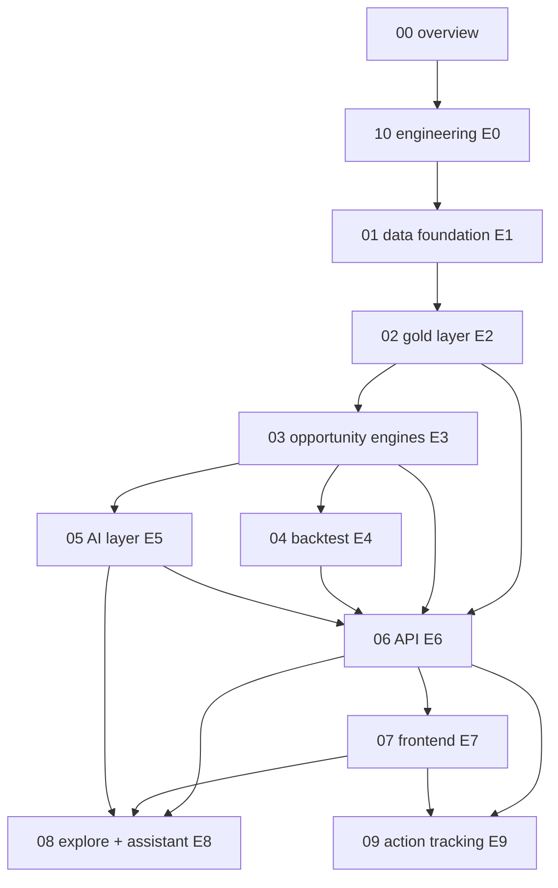

# Specs index

Status: DRAFT for review. Source of truth for decisions is
docs/decisions.md; these specs elaborate them. Anything unknown is
a placeholder `[x]` or an `OPEN QUESTION:`.

| # | Spec | Epic | Purpose |
|---|------|------|---------|
| 00 | [overview](00-overview.md) | all | Vision, users, scope, glossary |
| 01 | [data-foundation](01-data-foundation.md) | E1 | Bronze and silver, quality report |
| 02 | [gold-layer](02-gold-layer.md) | E2 | Star schema, marts, net sales view |
| 03 | [opportunity-engines](03-opportunity-engines.md) | E3 | Four engines, scoring, value |
| 04 | [backtest](04-backtest.md) | E4 | As-of replay, hit rate, lift |
| 05 | [ai-layer](05-ai-layer.md) | E5 | Evidence, Gemini JSON, storage |
| 06 | [api](06-api.md) | E6 | Endpoints, allow-listed query layer |
| 07 | [frontend](07-frontend.md) | E7 | Screens, tokens, states, a11y |
| 08 | [explore-assistant](08-explore-assistant.md) | E8 | Explore and chat assistant |
| 09 | [action-tracking](09-action-tracking.md) | E9 | Approve/assign/defer, app.duckdb |
| 10 | [engineering](10-engineering.md) | E0 | Repo, uv, config, CLI, CI |

Epic mapping follows docs/decisions.md section 10. Plan stories for
E0 (spec 10) and E1 (spec 01) first.

## Dependency graph

An arrow `A --> B` means "B depends on A".

## Cross-cutting conventions
- Table names: `bronze_*`, `silver_*`, `dim_*`, `fact_*`, `mart_*`,
  `opp_*`; app state tables prefixed `app_`.
- Every business parameter lives in config/settings.yaml (spec 10).
- Every spec ends with `OPEN QUESTION:` items; the consolidated,
  ranked list is in the PR description.
